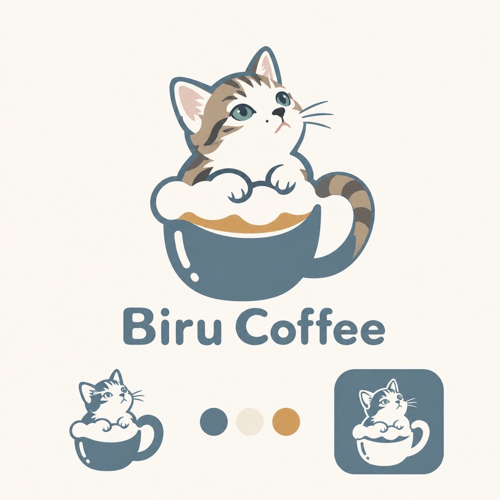

# 品牌

碧露的 Logo、品牌故事與紙本菜單版型。

## 碧露的故事

碧露是我貓的名字，取自台語、日文的啤酒，希望能鏘鏘的可愛又好叫，帶來歡樂的氣氛。

碧露是小山前同事的朋友，在恆春路邊撿到的斷手貓媽媽生的小孩，她媽媽身上有各種顏色花紋，黑、黃、咖啡、白、虎斑夾雜，很壯有霸氣很像黑道老大。

碧露是天生容易緊張的貓貓，會跳到很高的櫃子上遠遠俯瞰周遭一切，除了主人以外都不給碰，抱抱只能十秒，但喜歡摸摸和拍屁屁很傲嬌，叫聲是「啊啊啊啊啊」，是很喜歡跟人講話的貓貓，會黏踢踢跟著主人身後的小跟班，特色是碧綠色的眼睛和臉上有一顆美人瘤，身上的毛很像兔毛一樣柔軟滑順。

## 店的初衷

店的初衷是希望提供一個舒適的空間、貼心的服務、美味的餐食，如果碧露喜歡，你一定也會喜歡的。

## Logo

| 項目   | 內容                                                                     |
| ------ | ------------------------------------------------------------------------ |
| 檔案   | [logo.jpg](logo.jpg)（1254×1254 JPG，目前唯一的原稿）                    |
| 主圖   | [logo-mark.jpg](logo-mark.jpg)（從原稿裁出貓與杯子，菜單頁首用）         |
| 元素   | 咖啡、啤酒、貓（舉例：貓貓坐在啤酒奶泡上，尾巴是咖啡杯手柄）             |
| 風格   | 看起來簡約舒適，有點日系的風格，但還是要有咖啡廳的感覺                   |
| 向量檔 | （待製作，給廠商印刷用，見[餐具設計](../tableware.md#給廠商的檔案清單)） |

### 配色

從 Logo 原稿取色，JPG 取色有誤差，製作向量檔時再定正式色號。

| 名稱   | 色碼    | 用途             |
| ------ | ------- | ---------------- |
| 藍灰   | #617B88 | 主色、線條、文字 |
| 奶泡白 | #F0E7D8 | 奶泡、底色       |
| 琥珀   | #CE9B5C | 咖啡、啤酒、點綴 |
| 米白   | #FCF7F1 | 背景             |

## 紙本菜單

[menu.html](menu.html) 是 A4 紙本菜單的版型，用瀏覽器開啟後列印或另存 PDF。
目前的樣子見 [previews/menu.png](previews/menu.png)。

品項、價格與說明以系統菜單為準：列印前從後台「匯出菜單 CSV」取得最新內容，再更新這個檔案。
檔案中目前的品項與價格取自 [recipes.md](../recipes.md)。
