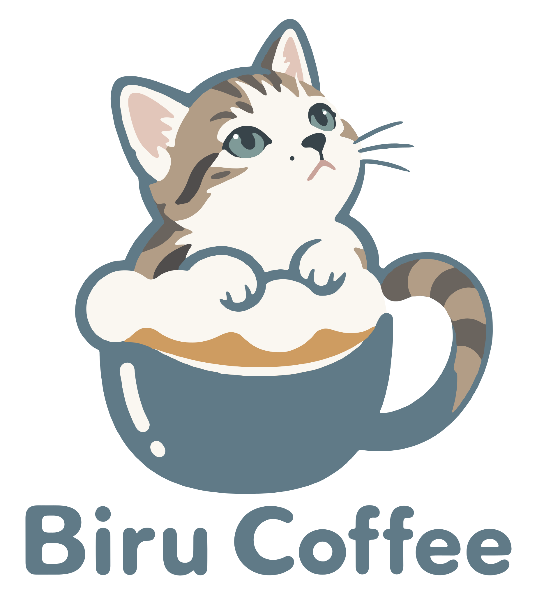

# 品牌

碧露的品牌故事、Logo、使用規範、線上素材與紙本菜單版型。

## 碧露的故事

碧露是我貓的名字，取自台語、日文的啤酒，希望能鏘鏘的可愛又好叫，帶來歡樂的氣氛。

碧露是小山前同事的朋友，在恆春路邊撿到的斷手貓媽媽生的小孩，她媽媽身上有各種顏色花紋，黑、黃、咖啡、白、虎斑夾雜，很壯有霸氣很像黑道老大。

碧露是天生容易緊張的貓貓，會跳到很高的櫃子上遠遠俯瞰周遭一切，除了主人以外都不給碰，抱抱只能十秒，但喜歡摸摸和拍屁屁很傲嬌，叫聲是「啊啊啊啊啊」，是很喜歡跟人講話的貓貓，會黏踢踢跟著主人身後的小跟班，特色是碧綠色的眼睛和臉上有一顆美人瘤，身上的毛很像兔毛一樣柔軟滑順。

## 店的初衷

店的初衷是希望提供一個舒適的空間、貼心的服務、美味的餐食，如果碧露喜歡，你一定也會喜歡的。

## Logo

| 項目   | 內容                                                                     |
| ------ | ------------------------------------------------------------------------ |
| 原稿   | [logo.jpg](logo.jpg)（1254×1254 JPG）                                    |
| 向量檔 | [logo.svg](logo.svg)／[logo.pdf](logo.pdf)：貓與杯子加 Biru Coffee 字樣  |
| 主圖   | [logo-mark.svg](logo-mark.svg)／[logo-mark.pdf](logo-mark.pdf)：貓與杯子 |
| 文字標 | [wordmark.svg](wordmark.svg)／[wordmark.pdf](wordmark.pdf)：Biru Coffee  |
| 元素   | 咖啡、啤酒、貓（舉例：貓貓坐在啤酒奶泡上，尾巴是咖啡杯手柄）             |
| 風格   | 看起來簡約舒適，有點日系的風格，但還是要有咖啡廳的感覺                   |

向量檔照原稿描製，對照見 [previews/logo-vector.png](previews/logo-vector.png)。SVG 給網頁與系統用；PDF 給印刷用，全為向量、文字已轉外框、色彩為 CMYK，可任意縮放。

彩色版的貓身與奶泡填滿奶泡白，只有杯子把手內側透明，放在任何底色上都一樣，見 [previews/logo-backgrounds.png](previews/logo-backgrounds.png)。

待製作（要重新設計，不能從彩色版直接轉色或描圖）：

- 單色版：餐具、紙杯等單色印刷用，參考 [logo.jpg](logo.jpg) 左下的小圖
- App 圖示：favicon、PWA、社群頭像用，參考 [logo.jpg](logo.jpg) 右下的小圖

前台與後台的 favicon、PWA 圖示目前暫用照片（兩個 repo 的 `app/icon.svg`、`app/apple-icon.png`、`app/favicon.ico`、`public/icon-192x192.png`、`public/icon-512x512.png`），App 圖示完成後一起替換。

### 配色

向量檔使用以下色彩。CMYK 以 FOGRA39（Coated）相對比色換算，正式色號以印刷廠的色彩描述檔為準。
印刷條件見[印刷規格](#印刷規格)。

貓身上的白色印奶泡白，不留紙白。

| 名稱     | RGB     | CMYK            | 用途                   |
| -------- | ------- | --------------- | ---------------------- |
| 藍灰     | #607A87 | C62 M36 Y31 K25 | 主色、輪廓、杯身、文字 |
| 奶泡白   | #FAF7F1 | C4 M3 Y7 K0     | 奶泡、貓身白色、背景   |
| 拿鐵琥珀 | #CE9C61 | C17 M40 Y67 K7  | 咖啡、點綴             |
| 虎斑棕   | #B29D86 | C33 M36 Y47 K6  | 貓毛                   |
| 斑紋深棕 | #6A645E | C58 M52 Y55 K30 | 虎斑                   |
| 斑紋深灰 | #504D4C | C67 M60 Y58 K45 | 虎斑暗部               |
| 耳朵粉   | #E2C6BA | C13 M26 Y27 K0  | 耳朵                   |
| 瞳孔青   | #7F9A98 | C53 M27 Y36 K10 | 眼睛                   |
| 眼鼻深藍 | #38444A | C80 M57 Y50 K55 | 瞳孔、鼻子、美人瘤     |
| 嘴巴粉   | #C9A39A | C22 M38 Y35 K5  | 嘴巴                   |
| 高光白   | #FFFFFF | C0 M0 Y0 K0     | 眼睛高光               |

## 使用規範

給廠商、印刷與線上素材共用的規則。尺寸為建議值，打樣後依實際效果調整。

### 名稱

招牌用英文的 Logo（Biru Coffee）。
「碧露咖啡」是招牌飲品的名稱（見 [recipes.md](../recipes.md#碧露咖啡)），點餐與菜單照系統菜單的品名。

系統目前使用的名稱與標語：

| 項目                     | 內容                                                                      | 位置                                                                                          |
| ------------------------ | ------------------------------------------------------------------------- | --------------------------------------------------------------------------------------------- |
| 網站名稱、信件寄件人名稱 | Biru Coffee                                                               | biru、biru-admin 的 `messages/*/metadata.json`；biru-api 的 `src/common/constants/product.ts` |
| PWA 名稱                 | 前台 Biru Coffee；後台 Biru Coffee Admin（主畫面上的短名稱為 Biru Admin） | biru、biru-admin 的 `app/manifest.ts`（YuanShuoHsu/biru#203、YuanShuoHsu/biru-admin#363）     |
| 標語                     | 為你的每一天，沖煮一杯好咖啡。（英文：Coffee, crafted for your day.）     | biru 的 `messages/*/home.json`、`messages/*/metadata.json`                                    |

### 版本選用

| 版本   | 檔案                                                           | 使用時機                                         |
| ------ | -------------------------------------------------------------- | ------------------------------------------------ |
| 完整   | [logo.svg](logo.svg)／[logo.pdf](logo.pdf)                     | 招牌、菜單封面、名片等第一次看到品牌名稱的地方   |
| 主圖   | [logo-mark.svg](logo-mark.svg)／[logo-mark.pdf](logo-mark.pdf) | 版面已經寫出店名（菜單頁首、桌卡）或空間是方形時 |
| 文字標 | [wordmark.svg](wordmark.svg)／[wordmark.pdf](wordmark.pdf)     | 橫向窄長的位置（杯身側邊、提袋側面、網頁頁尾）   |

單色版與 App 圖示尚未製作（見 [Logo](#logo)）；要單色印刷的品項先用素面或貼紙，不要自行把彩色版轉成單色。

### 最小尺寸

| 版本   | 印刷（寬） | 螢幕（寬） |
| ------ | ---------- | ---------- |
| 完整   | 30mm       | 120px      |
| 主圖   | 15mm       | 48px       |
| 文字標 | 25mm       | 100px      |

比最小尺寸更小時，鬍鬚、眼睛高光與斑紋會糊掉。

### 留白

Logo 四周至少保留 Logo 寬度的十分之一，不放文字、圖片或裁切線。

### 底色

- 可以：米白、白、淺色或深色的素色底。彩色版的貓身與奶泡已填滿奶泡白，深色底也能用，見 [previews/logo-backgrounds.png](previews/logo-backgrounds.png)。
- 避免：藍灰底（輪廓與杯身會消失）、花紋或照片等雜亂的底。

### 禁止事項

- 拉伸、壓扁、旋轉或傾斜
- 改顏色、加陰影、外框、漸層或其他特效
- 改變貓與 Biru Coffee 字樣的位置或比例
- 用 [logo.jpg](logo.jpg) 原稿放大印刷（解析度不足），一律用 SVG 或 PDF
- 用字型重打 Biru Coffee：字樣是圖形，請用 [wordmark.svg](wordmark.svg)

### 字體

| 用途                 | 字體                                                                            | 授權                                                                  |
| -------------------- | ------------------------------------------------------------------------------- | --------------------------------------------------------------------- |
| 中文、英文內文與標題 | [Noto Sans TC（思源黑體）](https://fonts.google.com/noto/specimen/Noto+Sans+TC) | [SIL Open Font License 1.1](https://openfontlicense.org/)，可免費商用 |
| 日文                 | [Noto Sans JP](https://fonts.google.com/noto/specimen/Noto+Sans+JP)             | [SIL Open Font License 1.1](https://openfontlicense.org/)，可免費商用 |
| 韓文                 | [Noto Sans KR](https://fonts.google.com/noto/specimen/Noto+Sans+KR)             | [SIL Open Font License 1.1](https://openfontlicense.org/)，可免費商用 |
| 簡體中文             | [Noto Sans SC](https://fonts.google.com/noto/specimen/Noto+Sans+SC)             | [SIL Open Font License 1.1](https://openfontlicense.org/)，可免費商用 |

[menu.html](menu.html) 與系統產生的紙本（YuanShuoHsu/biru-api#569、YuanShuoHsu/biru-api#570）都用這套字體。
前台與後台網站也依語言使用這套字體：繁體中文與英文用 Noto Sans TC，日文用 Noto Sans JP，韓文用 Noto Sans KR，簡體中文用 Noto Sans SC。
系統產生的紙本依語系選字型，該字型缺字時改用其他 Noto Sans。

### 印刷規格

系統產生的紙本 PDF（YuanShuoHsu/biru-api#569、YuanShuoHsu/biru-api#570）都要依這個規格輸出。
[menu.html](menu.html) 用瀏覽器列印或另存的 PDF 是 RGB，只能看版面，不能拿去印。

| 項目     | 規格                                                                                                                                                                         |
| -------- | ---------------------------------------------------------------------------------------------------------------------------------------------------------------------------- |
| 印刷條件 | [FOGRA39](https://registry.color.org/cmyk-registry/fogra39)：ISO 12647-2:2004/Amd 1 平版印刷、塗佈紙；和[配色](#配色)的 CMYK 換算基準相同                                    |
| 檔案格式 | PDF/X-1a:2003（ISO 15930-4，見 [PDF/X 應用說明](https://printtechnologies.org/standards/files/pdf-x-application-notes_v4-sep06.pdf)）：只用 CMYK、字型全部內嵌、沒有透明     |
| 色彩描述 | 只寫 ICC 登錄的條件名稱 FOGRA39，不內嵌 ICC 檔；登錄的標準條件可以不附描述檔（[Adobe Technote 5413](https://printtechnologies.org/standards/files/technote5413.pdf) 表 1.2） |
| 尺寸     | 實際尺寸、不出血；出血與裁切線尚未提供                                                                                                                                       |

印刷廠若用其他印刷條件（例如 Japan Color），[配色](#配色)的 CMYK 要依該條件重新換算，biru-api 的紙本 PDF 也要一起改。

## 社群與線上素材

| 平台                | 素材             | 規格                                                                                                                                    | 狀態                                        |
| ------------------- | ---------------- | --------------------------------------------------------------------------------------------------------------------------------------- | ------------------------------------------- |
| Google 商家         | 標誌、封面、照片 | [JPG 或 PNG，10KB～5MB，建議 720×720px、最小 250×250px](https://support.google.com/business/answer/6103862)；標誌與封面官方沒有另訂尺寸 | 標誌待 App 圖示；封面與店內照片待開幕前拍攝 |
| Instagram、Facebook | 大頭貼           | 正方形上傳、顯示為圓形，Logo 置中並留白，四角會被裁掉                                                                                   | 待 App 圖示                                 |
| Instagram、Facebook | 開幕公告貼文     | 用品牌色與字體，照片優先於插圖                                                                                                          | 待開幕日期確定                              |

照片要符合實際店況，Google 的規範也要求照片對焦清楚、光線充足、不要過度修圖。

## 紙本菜單

[menu.html](menu.html) 是 A4 紙本菜單的版型，用瀏覽器開啟後列印或另存 PDF。
目前的樣子見 [previews/menu.png](previews/menu.png)。

品項、價格與說明以系統菜單為準。正式的紙本菜單改由系統依這個版型直接產生 PDF（YuanShuoHsu/biru-api#569），這個檔案只是版型稿，目前的品項與價格取自 [recipes.md](../recipes.md)。
