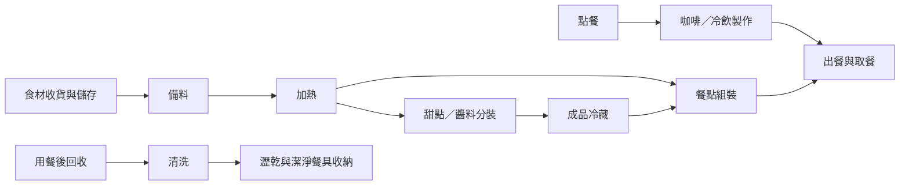

# 店內設備擺放規劃

依[設備購買清單](equipment.md)與[食譜](recipes.md)整理的分區草案。店面分上下兩層，每層約 100 坪、合計約 200 坪；作業區（後場、吧台、點餐與出餐）全部在一樓，二樓整層是座位區。實際格局（長寬比例、柱位、出入口、樓梯位置）與同時作業人數尚待確認，先規劃設備間的相鄰關係，再決定位置與尺寸。

## 分區配置

內用座位一、二樓都有，分布見 [3D 示意](#3d-示意)。

會影響尺寸的幾點：

- 磨豆到萃取之間要留得下單手操作的檯面，杯具與牛奶取用位置在咖啡機一臂內
- 備料台與分裝台要放得下整批材料與容器，冷藏櫃、冷凍櫃同樣以整批容器計算容量
- 儲物櫃依每日用量與補貨量估算，清潔用品與乾貨、包材分開收納

## 吧台立面

高度與視線要從顧客站的位置看才看得出來。

- 吧台前緣比工作檯高，檯面下的作業與雜物顧客看不到；出餐段刻意做低，交付時不必越過高檯
- 顧客視線約 1.55m，這條線以上的層架、機器頂部都是門面的一部分
- 吧台內側工作檯採日系商用標準 0.8m，與工作台冷藏、冷凍（同為 4 呎、高 800mm）齊平，可接成連續檯面
- 製冰機是桌上型，放上 0.8m 工作檯後頂部約 1.62m，高過顧客視線；正面朝向與周邊線材要當門面整理

## 3D 示意

後台「店內配置」頁（biru-admin `/store-layout`，限平台管理員）可切換一樓／二樓，並旋轉、切換斜視與俯瞰視角，或改用跟隨角色、角色視角操控角色走動。已定型號的設備（磨豆機、製冰機、手沖壺）用[購買清單](equipment.md)的實際尺寸，每層取 15.75m × 21m × 2.8m（330.75 ㎡，約 100 坪），兩層合計 661.5 ㎡、約 200 坪；面寬與縱深比例及其餘設備仍是假設值。樓板厚度以 0.25m 估，樓層高 3.05m、建物內部總高約 5.85m。量測或定型號後改 biru-admin 的 `constants/storeLayout.ts` 即可重算。

兩層是上下堆疊的：選一樓只畫一樓，選二樓連同一樓一起畫，二樓樓板在樓梯井處開口。樓梯是實際的半迴轉梯（17 階、級高 0.179m、級深 0.27m，兩段各 8 階夾一座 1.2m 平台），可用方向鍵或 WASD 操控角色走上去，走到哪層畫面就跟著切到那層。跨樓層的坪數與座位關係看下面的坪數分配。

坪數分配：

| 樓層 | 內容                                                                                                  | 座位                               |
| ---- | ----------------------------------------------------------------------------------------------------- | ---------------------------------- |
| 一樓 | 後場（清洗、加熱、備料、冷藏冷凍、儲物）到前檯佔縱深 4.8m，約 23 坪；其餘約 77 坪是點餐、候餐與座位區 | 10 張四人桌、8 張二人桌，共 56 席  |
| 二樓 | 整層約 100 坪全是座位區，另有回收檯供顧客放置用畢餐具                                                 | 15 張四人桌、14 張二人桌，共 88 席 |

合計 144 席。樓梯佔 1.7m × 3.6m，兩層同位置靠右牆，該處靠牆桌位讓給樓梯；以半迴轉梯估算，升高 3.05m 需 17 階（級高 0.179m、級深 0.27m），兩段梯段各 8 階加 1.2m 平台，落在 3.36m 內，塞得進這塊佔位。主走道留 1.7m 以上。席數、桌距與樓梯尺寸要用[參考店家](#參考店家現場觀察)的實測值回頭校正。

它能回答的是走道寬度、檯面高度、視線遮擋、設備占位這類問題；材質、燈光、裝潢效果不在範圍內，那些看[參考店家](#參考店家現場觀察)的實景。

## 工作動線

以下表示作業順序，實際左右方向依店面格局調整。

## 設備定位表

尺寸與安裝條件在型號確定後填入；設備本體以外，還要計入開門、操作、散熱與維修空間。

| 設備                            | 規劃位置                                         | 定位前需確認                                          |
| ------------------------------- | ------------------------------------------------ | ----------------------------------------------------- |
| Victoria Arduino 咖啡機         | 咖啡工作區，磨豆機旁                             | 型號、機身尺寸、檯面承重、供排水及電源條件            |
| Mahlkönig E80S GbW 磨豆機       | 咖啡機旁，鄰接填壓位置                           | 豆槽補豆高度、清潔拆卸空間、插座位置                  |
| HOSHIZAKI DCM-115M 製冰機       | 冷飲工作區檯面，果汁機旁                         | 檯面承重、取冰操作方向、供排水、散熱方向與維修空間    |
| 果汁機                          | 調飲檯面，靠近製冰機                             | 型號、杯體取放高度、清洗路徑                          |
| Fellow EKG PRO 手沖壺           | 咖啡工作區，咖啡機與果汁機之間                   | 110V 1200W 插座與同迴路負載、注水取用位置             |
| RATIONAL 烤箱                   | 廚房加熱區                                       | 型號、開門方向、熱盤落檯、供排水與排氣條件            |
| Panasonic NE-186B 微波爐        | 廚房加熱區，烤箱旁                               | 220V 專用迴路（13.6A）、檯面深度 508mm、散熱空間      |
| HOSHIZAKI RT-126MA-T 工作台冷藏 | 咖啡工作區，咖啡機下方，作為 0.8m 工作檯的一段   | 與相鄰工作台齊高（可調 790–830mm）、散熱空間          |
| HOSHIZAKI FT-126MA-T 工作台冷凍 | 冷飲工作區，果汁機與製冰機下方，與工作台冷藏相接 | 冰淇淋挖取溫度（約 -14℃）、與相鄰工作台齊高、散熱空間 |
| HOSHIZAKI HR-128MA-T 冷藏櫃     | 備料與分裝區旁                                   | 開門方向、散熱空間、整批容器能否放入                  |
| HOSHIZAKI HF-128MA-T 冷凍櫃     | 食材儲存區，靠近備料台，與冷藏櫃並排             | 開門方向、散熱空間、取料及補貨空間                    |

## 尚未列入購買清單的工作位置

| 項目                 | 用途                             | 待確認                                             |
| -------------------- | -------------------------------- | -------------------------------------------------- |
| 備料台與分裝台       | 食材秤重、切配、奶酪與紅醬分裝   | 是否共用檯面、整批容器所需面積                     |
| 鍋具加熱位置         | 奶酪加熱、紅醬熬煮               | 熱源設備與鍋具規格                                 |
| 清洗、洗手與瀝乾位置 | 器具清洗、手部清潔、潔淨餐具暫放 | 既有水槽與供排水位置、是否配置洗碗設備             |
| 咖啡渣與垃圾收集     | 製作途中與收店清理               | 靠近各作業點的收集位置與清運路徑                   |
| 收納櫃／層架         | 杯盤、乾貨與包材                 | 每日用量與補貨量，對照[餐具清單](tableware.md)安排 |
| 出餐檯與回收檯       | 成品交付、髒餐具暫放             | 分開定位，確認尖峰時段暫放量                       |

## 參考店家現場觀察

店面尺寸定案前，先到[參考店家](references.md)實地看同規模店的做法。每家記一份，重點是能帶回來的數字與拍得到的關係，不是裝潢風格。

| 觀察項目           | 要記的內容                                             | 為什麼要看                                 |
| ------------------ | ------------------------------------------------------ | ------------------------------------------ |
| 吧台尺寸           | 前緣高度、檯面深度、整段長度（用磁磚或地板格數估）     | 決定顧客側視線與工作側檯面，是本文件最缺的 |
| 工作走道           | 吧台與後方檯面之間的淨寬、兩人交會時是否要側身         | 決定後場深度，也決定尖峰能站幾個人         |
| 機器排列           | 磨豆機、咖啡機、製冰機的前後左右關係與朝向             | 對照本文件的咖啡、冷飲工作區排法           |
| 出餐與回收         | 出餐位置、髒餐具回收位置、兩者距離                     | 驗證回收與出餐分開是否可行                 |
| 點餐與候餐         | 排隊動線起點、候餐站位、會不會擋住入口或座位           | 顧客動線的實測依據                         |
| 座位密度           | 桌距、走道寬、座位數與店面面積的比例                   | 估內用座位數                               |
| 樓梯與樓層動線     | 梯寬、級高級深、上下樓與送餐路徑、二樓是否另設服務點   | 二樓座位靠什麼支援，決定回收檯與人力配置   |
| 檯面下與層架       | 檯下放什麼（冷藏、垃圾、杯具）、層架高度與伸手可及範圍 | 本文件尚未規劃的收納位置                   |
| 顧客看得到的後場   | 站在點餐位置能看到哪些設備與作業                       | 決定隔間高度與機器擺放的正面朝向           |
| 尖峰時段（可再訪） | 同時作業人數、卡住的位置、等待長度                     | 空店時看不出來的瓶頸                       |

記錄方式：每項拍一張照，能量的用捲尺或以地磚尺寸換算，數字回填本文件的[現場量測與定案](#現場量測與定案)與設備定位表。

## 現場量測與定案

| 資料       | 待填內容                                                                  |
| ---------- | ------------------------------------------------------------------------- |
| 店面尺寸   | 各層室內長寬（每層以 100 坪規劃）、各層天花高度、樓板厚度、柱位與固定隔間 |
| 出入口     | 顧客入口、工作人員進出與收貨位置                                          |
| 樓梯       | 位置、淨寬、級高與級深、是否為唯一上下動線                                |
| 顧客區     | 內用座位、候餐與取餐位置                                                  |
| 工作人數   | 平常及尖峰同時作業人數                                                    |
| 水電與排氣 | 既有插座、配電、供排水與排氣位置                                          |
| 設備尺寸   | 最終型號、安裝圖與廠商要求的預留空間                                      |

取得尺寸後，先繪製等比例平面圖，再用實際設備占位模擬咖啡、冷飲、餐點與清洗作業；確認開門、補貨及人員交會不互相阻擋後，定案設備位置與管線。
